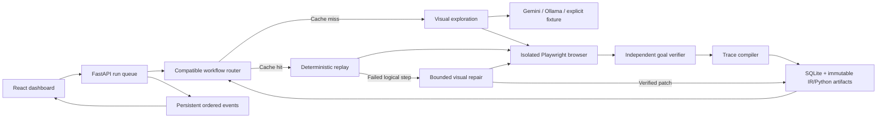

# Architecture

Observations number native range handles and ARIA sliders, including controls in open shadow roots. Form controls take priority over product links within the observation limit. Badges sit outside control text. ARIA is read before marking; screenshot capture verifies target identities, values, options and geometry afterward. After three unstable captures, repeatedly changing controls are temporarily omitted from both image numbering and the action menu. Capture makes at most six attempts and reports omissions to the model. A new observation reconsiders omitted controls. Duplicate DOM IDs receive scoped CSS paths. Each screenshot has a matching observation JSON artifact.

Compound search/language requests retain their full text and separate follow-up operations from search keywords, respecting quoted terms. On a cache miss, the selected Gemini or Ollama provider interprets compound requests into search data and requested objectives, without prescribing selectors or browser sequences. Each objective needs separately tagged outcome evidence before completion. Interpretation requests use the same model budget, pacing and token ledger as browser decisions. Successful workflows retain their interpretation for the exact originating request; replay reuses it without inference. Legacy compound workflows without this evidence are excluded from routing.

Completion responses explicitly name expected comparison values, with parameter references where applicable. A submitted-search assertion retains a matched public search URL across subsequent result navigation, excluding unrelated URL parameters. Native media assertions read paused/ended state, readiness and playback position, including open shadow roots and visible frames. Playback objectives require media evidence; a video title cannot substitute for it. Verification waits up to the configured condition timeout for asynchronous playback to start, with no clicks or model requests. These read-only assertions work in runtime replay and newly generated standalone exports. Incomplete evidence receives specific correction feedback without repeating already completed actions. Export runs clear their temporary evidence history before executing.

Clearly identified search and price fields offer compatible parameter bindings. The model can choose a numeric `adjust` action for each slider handle. This generic operation uses trusted keyboard input, reads the displayed numeric value after each change, reacquires replaced elements and commits on blur. Raw range indices are not assumed to equal currency amounts. Compilation, healing, replay and standalone exports share the same slider behavior and numeric postconditions. Price completion on Amazon additionally verifies submitted URL filter bounds; an edited handle alone cannot prove filtering.

Ollama uses staged decisions: the first grammar accepts only a human-readable choice naming the current operation/control, intent and confirmation flag. The choice binds to an immutable candidate ID internally. Bound clicks, keyboard operations, task inputs and native options execute from that selection. Navigation, literal input and general completion evidence request only their required data in a second model call. That call cannot change the selected operation. All stages retain provider usage and share the run's model-request budget. Reversible locator/action failures trigger a fresh observation and bounded model replanning; mutations with uncertain outcomes are not retried automatically.

Simple requests to click/press/tap a named button, link or tab receive a `control_name` parameter and a `control_activated` assertion. The browser records actual successful activations; merely seeing a link cannot complete that request. Recognition supplies an outcome constraint, not browser steps. The LLM still decides how to find and activate the control. Equivalent wording shares a cache key; fixed target values and explicit outcome conditions prevent reuse for the wrong control. Document-replacement errors retry only the read operation, allowing observations to settle during navigation.

JIT-UI turns a successful observed browser trace into a parameterized workflow. The browser performs the actions for every provider; the model proposes structured actions and never supplies executable Python.

The general website entry accepts arbitrary HTTP(S) addresses and free task descriptions. Resolution identifies atomic search/language operations or retains a compound/general task. Every cache miss uses the selected Gemini or Ollama model. Opening the requested address bootstraps the browser; subsequent operations come from the model's selections from current DOM affordances. Candidates bind action, target, parameter or exact native option without specifying an order. Popup context is read-only observation; dismissal and manual handoff are model decisions. Literal input and free navigation remain available. The compiler preserves stable outcome assertions and binds requested values in both actions and assertions. Cache compatibility checks website, operation, schema, fixed values and explicit completion requirements; legacy native workflows are rejected.

Interactive runs can hand verification/login steps to the user through a visible browser and persisted pending review. Final booking/payment actions similarly wait for explicit approval before execution. These pauses retain the browser context and resume the same run. The queue cancels or recovers unfinished pauses on shutdown; approval is not cached for future runs. Token accounting includes every model attempt while zero-inference replay references the original measured learning run.

Blocked runs created without a visible browser offer a dashboard retry that preserves the task, provider and automation set while enabling manual browser interaction. The browser checkbox preference persists locally. Verification pauses suspend the active execution deadline until the user resumes or cancels. Resuming before verification is complete returns to the manual review with the same page and context; it does not close the session or ask the model to solve the challenge. Google access challenges remain manual steps.

`backend/src/jit_ui/` separates configuration, typed domain contracts, providers, browser observation/tracing, exploration, compilation, routing, storage, replay, healing, and API concerns. `frontend/` presents runs, screenshots, events, results, code, patch diffs, and workflow history. `chaos_testbed/` owns seeded shopping and order applications, independent result attributes, mutation controls, and fixture reset. `benchmarks/` owns reproducible evaluation and standalone reports. `scripts/` owns setup and process lifecycle tools.

SQLite stores authoritative run/event history and workflow versions. IR and Python are written to immutable version directories before the active version changes. Chroma is a rebuildable local index; compatibility checks against authoritative IR are required after retrieval. Restoring an older version changes the active pointer while preserving published versions.

Compilation prunes only proven reversible actions, binds values through parameter provenance, ranks semantic/DOM locator alternatives, validates typed IR, and syntax-checks generated Python. Exported workflows include the shared deterministic browser helpers, giving replay and export the same action and goal behavior.

Hot replay verifies each logical step and the final registered goal. Failed execution preserves the browser and completed prefix. A repair can dismiss an obstacle, open a relocated control, and execute the replacement action within configured bounds. A verified repair becomes a new version; subsequent hot runs reuse it. Mutation steps must check whether their result already took effect before retrying, avoiding duplicate shipment actions.

The app is local and single user, with one active run. Cancellation, reconnectable event sequences, and interrupted-run recovery are persisted. Amazon integration is limited to public product search; access challenges are reported as `BLOCKED`. Native desktop control, payments, general website support, multi-tenancy, and direct API compilation are outside the first release.
